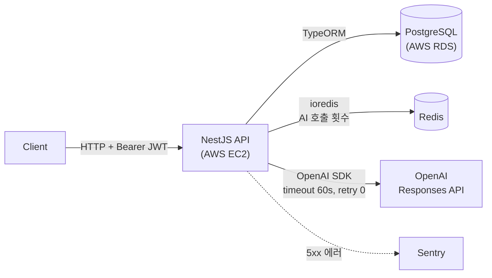
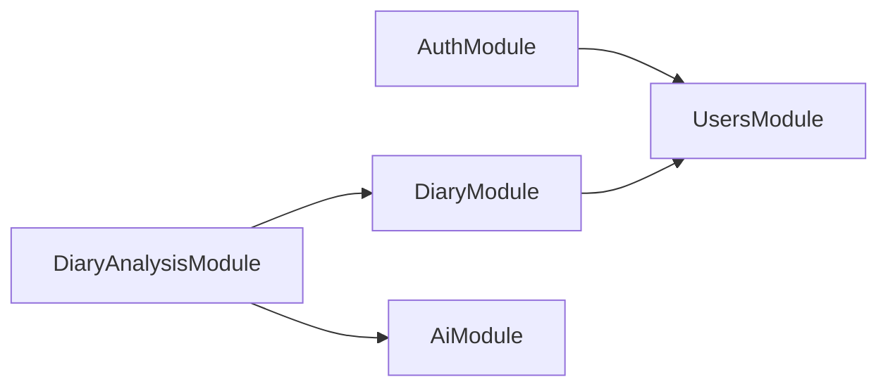
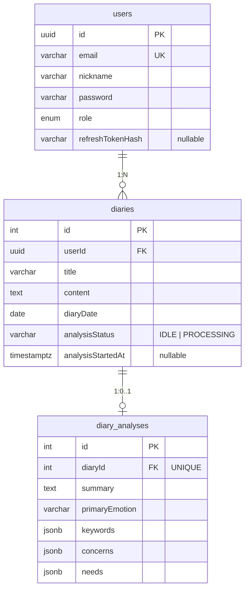
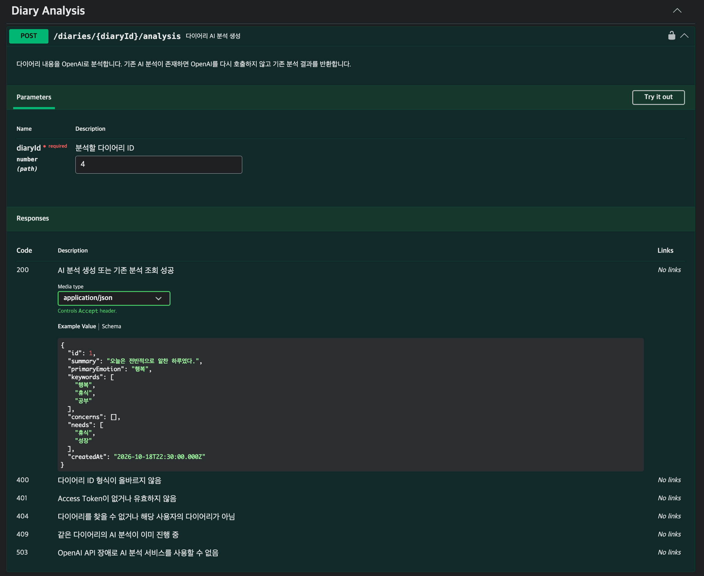

# Diary AI

다이어리를 작성하면 OpenAI가 본문을 분석해 **요약 · 주요 감정 · 키워드 · 걱정 · 욕구**를 돌려주는 다이어리 서비스의 백엔드 API입니다. (1인 개발)

## 1. 프로젝트 소개

### 배경과 해결하려는 문제

다이어리는 쓰는 것보다 다시 읽고 돌아보는 일이 더 어렵습니다. 이 서비스는 다이어리 하나를 구조화된 분석 결과로 바꿔서 그날의 감정과 고민을 바로 확인할 수 있게 합니다.

백엔드에서 다룬 핵심 문제는 다음과 같습니다.

| 문제                                               | 접근                                                                               |
| -------------------------------------------------- | ---------------------------------------------------------------------------------- |
| 외부 AI API는 느리고, 비용이 들고, 실패할 수 있다  | 다이어리당 분석 1회 저장 후 재사용, 동시 요청 시 1회만 호출, 실패 시 503 + 락 해제 |
| 다이어리 본문과 분석 결과가 어긋날 수 있다         | 본문이 바뀌면 기존 분석 삭제, 분석 중에는 본문 수정 차단                           |
| 사용자별 목록 조회는 데이터가 늘수록 비용이 커진다 | `(userId, diaryDate)` 복합 인덱스 + `EXPLAIN ANALYZE` 측정                         |

### 핵심 기능

- JWT 인증 (Access / Refresh Token, Refresh Token Rotation)
- 다이어리 CRUD, 본인 다이어리만 접근, 같은 날짜 중복 작성 방지
- 페이지 기반 목록 조회
- OpenAI 기반 다이어리 분석 생성 · 조회 (Redis로 사용자별 호출 횟수 제한)

## 2. 기술 스택

| 분류           | 기술                                                                                                                      | 근거                                                           |
| -------------- | ------------------------------------------------------------------------------------------------------------------------- | -------------------------------------------------------------- |
| Backend        | TypeScript, NestJS 11, Passport JWT, argon2, class-validator, Swagger, @nestjs/throttler                                  | `package.json`, `src/main.ts`                                  |
| Database       | PostgreSQL 17, TypeORM (마이그레이션으로 스키마 관리, `synchronize: false`)                                               | `docker-compose.yaml`, `src/config/typeorm.ts`                 |
| Cache / Store  | Redis 7, ioredis (사용자별 AI 분석 호출 횟수 카운터)                                                                      | `docker-compose.yaml`, `src/redis/redis.module.ts`             |
| AI             | OpenAI Node SDK, Responses API + JSON Schema 구조화 출력                                                                  | `src/ai/ai.service.ts`                                         |
| Infrastructure | AWS EC2 (수동 배포, forever로 프로세스 실행), AWS RDS (production DB, SSL 연결), Docker Compose (로컬 PostgreSQL · Redis) | `docker-compose.yaml`, `src/config/typeorm.ts`, `package.json` |
| Monitoring     | Sentry (`@sentry/nestjs`, 5xx 에러 수집, production에서만 전송)                                                          | `src/instrument.ts`, `src/common/exception-filter/http.exception-filter.ts` |
| CI             | GitHub Actions (main 대상 PR · main push 시 npm ci → build → test)                                                        | `.github/workflows/ci.yml`                                     |
| Test           | Jest, ts-jest, supertest (E2E)                                                                                            | `package.json`, `test/jest-e2e.json`                           |

## 3. 시스템 아키텍처



로컬 개발 환경에서는 Docker Compose로 띄운 PostgreSQL 17과 Redis 7을 사용합니다.

NestJS 안에서 요청은 다음 순서로 처리됩니다.

| 단계 | 구성 요소                                        | 역할                                                            |
| ---- | ------------------------------------------------ | --------------------------------------------------------------- |
| 1    | 전역 `ThrottlerGuard`                            | IP 기준 요청 횟수 제한, 초과 시 429                             |
| 2    | `AccessTokenGuard` / `RefreshTokenGuard`         | Bearer 토큰 검증 (Passport JWT)                                 |
| 3    | 전역 `ValidationPipe` (`whitelist`, `transform`) | DTO 검증, 정의되지 않은 필드 제거                               |
| 4    | Controller → Service                             | 비즈니스 로직, TypeORM으로 DB 접근, `AiService`로 OpenAI 호출   |
| 5    | 전역 `ClassSerializerInterceptor`                | 응답에서 `@Exclude()` 필드(`password`, `refreshTokenHash`) 제거 |

### 모듈 의존 관계



- OpenAI 호출은 `AiModule`에만 두어서, 분석 흐름(락, 저장)과 외부 API 호출 코드를 분리했습니다.

## 4. 주요 기능

### 회원가입 및 JWT 인증

| 항목               | 구현                                                                                                                                        | 이유                                         |
| ------------------ | ------------------------------------------------------------------------------------------------------------------------------------------- | -------------------------------------------- |
| 비밀번호 저장      | argon2 해시                                                                                                                                 | 평문 저장 금지, 단방향 해시                  |
| 토큰               | Access 15분 / Refresh 7일, 서로 다른 시크릿                                                                                                 | Access 탈취 시 피해 시간 제한                |
| Refresh Token 저장 | 원문이 아닌 argon2 해시를 `users.refreshTokenHash`에 저장                                                                                   | DB 유출 시 토큰 재사용 방지                  |
| 재발급             | 새 Refresh Token을 발급하고 해시를 교체 (Rotation)                                                                                          | 이전 Refresh Token은 더 이상 통과하지 못함 (동시 요청 예외는 [11절](#11-개선-예정-사항)) |
| 로그아웃           | `refreshTokenHash`를 `NULL`로 변경                                                                                                          | 서버 측에서 재발급 차단 (동시 요청 예외는 [11절](#11-개선-예정-사항)) |
| 응답 노출 차단     | `password`, `refreshTokenHash`에 `@Exclude()` + 전역 `ClassSerializerInterceptor`                                                           | 엔티티를 그대로 반환해도 민감 필드 제외      |
| 요청 횟수 제한     | 전역 `ThrottlerGuard`로 엔드포인트별 IP당 1분 60회. 로그인(`POST /auth/signin`) · AI 분석 생성(`POST /diaries/:diaryId/analysis`)은 1분 5회 | 비밀번호 무차별 대입과 OpenAI 비용 남용 완화 |

### 다이어리 CRUD

- 목록은 로그인한 사용자의 다이어리만 조회합니다. 상세 조회 · 수정 · 삭제는 먼저 `WHERE id = :id AND userId = :userId`로 소유권을 확인합니다. 다른 사용자의 다이어리는 **404**로 응답해 존재 여부를 노출하지 않습니다.
- 입력 검증: 제목 1~30자, 본문 1~5000자, `diaryDate`는 날짜 문자열이며 `@IsDateString({ strict: true })`로 `2026-02-30`처럼 그 달에 없는 날짜는 400으로 거부합니다.
- 같은 날짜 중복 방지: 작성 시 같은 날짜에 내 다이어리가 이미 있으면 **409**로 응답합니다. 수정으로 날짜를 바꿀 수 있지만, 바꾸려는 날짜에 내 다른 다이어리가 있으면 409로 응답합니다(수정 중인 다이어리 자신은 제외). 저장 전에 서비스에서 조회해 확인합니다.
- 수정 DTO는 `PartialType(..., { skipNullProperties: false })`로 만들어 필드 생략은 허용하고, `null` 입력은 거부합니다. (NOT NULL 컬럼에 `null`이 들어가 500이 나는 것을 막음)

### 다이어리 목록 및 페이지네이션

- `GET /diaries?page=1&take=20`, `take`는 1~100으로 제한합니다.
- `diaryDate` 내림차순 정렬, 응답은 `{ data, total }`.
- `findAndCount()` 사용 → 목록과 전체 건수를 함께 반환합니다. 조회 결과만으로 전체 건수를 알 수 없으면 TypeORM이 `COUNT` 쿼리를 추가로 실행합니다.

### AI 다이어리 분석

```
POST /diaries/:diaryId/analysis
  1. 본인 다이어리 확인 (없으면 404)
  2. 저장된 분석이 있으면 OpenAI 호출 없이 반환
  3. 조건부 UPDATE로 분석 락 선점 (실패하면 409)
  4. 락 획득 후 다이어리와 분석 결과를 다시 조회 (OpenAI에는 이때 읽은 본문을 보냄)
  5. 사용자별 호출 횟수 차감 (Redis, 24시간 10회 초과 시 429)
  6. OpenAI 호출 → diary_analyses에 저장
  7. finally: 내가 잡은 락만 해제
```

- 호출 횟수는 OpenAI 호출 직전에 차감하므로, 그 전에 끝나는 요청(저장된 분석 반환, 404, 락 선점 실패 409)은 횟수에 포함되지 않습니다. 반대로 한도를 넘어 429로 거절된 요청도 카운터는 증가합니다.
- IP 기준 `ThrottlerGuard`(1분 5회)는 짧은 시간 폭주 방어용으로 함께 유지합니다.

- 응답 형식은 JSON Schema(`strict: true`)로 고정해 필드 누락을 막았습니다.
- 스키마에는 글자 수 제한이 없어서, `primaryEmotion`의 길이(`.length`)가 DB 컬럼 길이(`varchar(50)`)인 50을 넘으면 저장하기 전에 실패(503)로 처리합니다. 그대로 저장하면 DB 에러로 500이 되기 때문입니다.
- OpenAI 실패 시 원본 오류는 서버 로그에만 남기고, 클라이언트에는 **503**으로 응답합니다.

## 5. 데이터베이스 설계



| 제약 · 인덱스                                            | 목적                                                                |
| -------------------------------------------------------- | ------------------------------------------------------------------- |
| `users.email` UNIQUE                                     | 이메일 중복 가입 방지 (애플리케이션 중복 확인과 별개로 DB에서 보장) |
| `diaries.userId` FK `ON DELETE CASCADE`                  | 사용자 삭제 시 다이어리 함께 삭제                                   |
| `diary_analyses.diaryId` FK `ON DELETE CASCADE` + UNIQUE | 다이어리당 분석 결과 최대 1건, 다이어리 삭제 시 함께 삭제           |
| `IDX_diaries_user_diary_date (userId, diaryDate)`        | 사용자별 목록 조회 (`WHERE userId ORDER BY diaryDate DESC`)         |
| `analysisStatus`, `analysisStartedAt`                    | 분석 락 상태와 획득 시각 (TTL 판단, 소유권 확인)                    |

- 분석 결과의 `keywords`, `concerns`, `needs`는 개수가 정해지지 않은 문자열 배열이고 개별 검색을 하지 않아서 별도 테이블 대신 `jsonb`로 저장했습니다.
- 스키마는 `synchronize: false`로 두고 마이그레이션 5개로만 변경했습니다. (`src/migrations`)

## 6. 기술적 문제 해결

상세 과정: [docs/TROUBLESHOOTING.md](./docs/TROUBLESHOOTING.md)

| 문제                                              | 원인                                                                                    | 해결                                                                                         | 검증                                                  |
| ------------------------------------------------- | --------------------------------------------------------------------------------------- | -------------------------------------------------------------------------------------------- | ----------------------------------------------------- |
| 동시 분석 요청 시 OpenAI 중복 호출                | "분석 있음?" 조회와 "분석 시작"이 분리되어 있어 사이에 다른 요청이 끼어듦               | `UPDATE ... WHERE analysisStatus = 'IDLE'` 한 문장으로 락 선점, `affected = 1`인 요청만 진행 | 단위 테스트 + 실제 DB 수동 검증                       |
| 서버가 죽으면 락이 `PROCESSING`으로 영구히 남음   | 락 해제를 애플리케이션의 `finally`에만 의존                                             | 락 TTL 5분. 만료된 락은 재획득 가능                                                          | 실제 DB 수동 검증                                     |
| 만료 후 늦게 끝난 작업이 새 작업의 락을 해제      | 해제 조건에 "누가 잡은 락인지"가 없음                                                   | 해제 조건에 획득 시각(`analysisStartedAt`) 포함                                              | 단위 테스트 + 실제 DB 수동 검증                       |
| 락만 바뀌어도 다이어리 `updatedAt`이 갱신됨       | TypeORM `@UpdateDateColumn`이 `update()` 시 `updatedAt = CURRENT_TIMESTAMP`를 자동 추가 | set에 `updatedAt: () => '"updatedAt"'` 지정                                                  | 실행 SQL 확인 + 실제 DB 수동 검증                     |
| 본문 수정 후 이전 본문의 분석이 남음              | 다이어리와 분석이 별도 테이블                                                           | 트랜잭션 안에서 다이어리 행을 잠그고, 본문이 실제로 바뀐 경우에만 분석 삭제                  | 단위 테스트 (분기)                                    |
| 분석 중에 본문을 고치면 옛 본문의 분석이 저장됨   | 분석이 시작된 뒤 본문이 바뀌어도 막는 장치가 없음                                       | 분석 락이 유효하면 본문 수정은 409, 분석은 락을 잡은 뒤 다이어리를 다시 읽어 그 본문을 보냄  | Postman 확인 예정 (DB에서 락 상태를 직접 만들어 재현) |
| 분석 중에 제목만 고쳐도 분석 락이 풀림            | `save()`가 미리 읽어 둔 엔티티의 락 컬럼(`IDLE`, `null`)까지 UPDATE                     | `update()`로 요청에 들어온 필드(와 TypeORM이 붙이는 `updatedAt`)만 수정해 락 컬럼은 건드리지 않음 | TypeORM 소스 확인                                     |
| OpenAI 장애                                       | 외부 API 실패 / 지연                                                                    | timeout 60초, 재시도 0회, 503 응답, `finally`로 락 해제                                      | 단위 테스트 + 실제 DB 수동 검증                       |
| IP 기준 제한으로는 사용자별 OpenAI 비용 통제 불가 | throttler는 IP · HTTP 요청 단위로 세고 카운트가 서버 메모리에 있음                      | OpenAI 호출 직전 Redis 카운터로 사용자별 24시간 10회, `INCR` + `EXPIRE`는 Lua로 원자화       | Postman (한도를 2로 낮춰 429 확인)                    |
| 달력에 없는 날짜(`2026-02-30`)로 작성하면 500     | `@IsDateString()` 기본 검사로는 `2026-02-30`처럼 그 달에 없는 날짜가 통과해, DB 저장 단계에서 에러 | `@IsDateString({ strict: true })`로 그 달에 있는 날짜인지까지 검사 → 400. 수정 DTO는 `PartialType`으로 같은 규칙을 상속 | 단위 테스트 + E2E (`strict` 제거 시 E2E가 500으로 실패하는 것 확인) |
| AI가 긴 감정 값을 주면 500                        | `primaryEmotion`은 `varchar(50)`인데, 엔티티의 `length`는 스키마 정의용이라 저장 전에 검사하지 않음 | 응답 파싱 직후 길이 검사, 넘으면 기존 `catch`가 503으로 변환 (락 해제도 기존 `finally`가 처리) | 이 분기를 직접 실행하는 자동 테스트는 아직 없음 |

**락 방식을 고른 이유**: PostgreSQL 행 락이나 advisory lock은 OpenAI 응답을 기다리는 동안 DB 커넥션을 점유합니다. 그래서 컬럼 2개와 조건부 UPDATE만으로 구현할 수 있는 TTL 락을 선택했습니다. OpenAI 호출 상한(60초)이 TTL(5분)보다 짧도록 맞췄습니다. 행 락(`SELECT ... FOR UPDATE`)은 다이어리 수정처럼 OpenAI를 기다리지 않는 짧은 트랜잭션에서만 씁니다.
이후 호출 횟수 제한을 위해 Redis를 도입했지만 락은 옮기지 않았습니다. DB 락도 모든 서버가 공유하므로 이미 여러 서버 환경에서 동작합니다. Redis로 옮겨서 얻는 것(DB 쓰기 감소, `updatedAt` 부작용 회피)은 지금 규모에서 문제가 아니거나 이미 해결한 반면, TTL과 소유권 확인은 다시 구현해야 하기 때문입니다. 락 갱신으로 인한 DB 부하가 문제가 되면 Redis `SET NX PX` + 토큰 기반 해제로 옮기는 것을 검토합니다.

**호출 횟수 제한에 Redis를 고른 이유**: IP 기준 throttler는 HTTP 요청 단위로 세고 카운트가 서버 메모리에 있어, OpenAI 호출만 사용자별로 셀 수 없고 재시작하면 초기화됩니다. DB `COUNT`는 조회와 비교 사이에 동시 요청이 끼어들 수 있습니다. Redis `INCR`은 원자적이고 TTL로 자동 초기화되며, `INCR`과 `EXPIRE` 사이의 race condition은 [Redis 공식 문서의 rate limiter 패턴](https://redis.io/docs/latest/commands/incr/)대로 Lua 스크립트로 묶었습니다.

## 7. 성능 개선

사용자별 다이어리 목록 조회에 `(userId, diaryDate)` 복합 인덱스를 추가하고 `EXPLAIN (ANALYZE, BUFFERS)`의 Execution Time을 비교했습니다.

| 조건   | 값                                                                                                |
| ------ | ------------------------------------------------------------------------------------------------- |
| 환경   | 로컬 PostgreSQL (Docker `postgres:17`)                                                            |
| 데이터 | `diaries` 약 100,003건, 대상 사용자 101건 ([시드 SQL](./src/diary/sql/seed-performance-data.sql)) |
| 쿼리   | `SELECT * FROM diaries WHERE "userId" = $1 ORDER BY "diaryDate" DESC`                             |
| 횟수   | 인덱스 적용 전 · 후 각 5회                                                                        |

|         |      평균 |    중앙값 |               범위 |
| ------- | --------: | --------: | -----------------: |
| 적용 전 | 15.952 ms | 13.740 ms | 11.378 ~ 21.507 ms |
| 적용 후 |  0.278 ms |  0.249 ms |   0.064 ~ 0.591 ms |

- 평균 기준 약 57배(실행 시간 98.3% 감소), 중앙값 기준 약 55배.
- DB 실행 시간만 측정했고, API 응답 시간은 포함하지 않습니다.
- 측정 쿼리에는 실제 API의 `LIMIT/OFFSET`과 `COUNT`가 빠져 있습니다. 한계와 재측정 계획은 [성능 트러블슈팅](./docs/TROUBLESHOOTING.md#1-다이어리-목록-조회-성능-개선-복합-인덱스)에 정리했습니다.

측정 SQL: [before](./src/diary/sql/performance/diary-list-before.sql) / [after](./src/diary/sql/performance/diary-list-after.sql) · 마이그레이션: [`AddDiaryUserDiaryDateIndex`](./src/migrations/1791653488772-AddDiaryUserDiaryDateIndex.ts)

## 8. API 명세

Swagger: 서버 실행 후 `http://localhost:3000/api`. 토큰은 `Authorization: Bearer <token>` 헤더로 보냅니다.




| Method | Endpoint                     | 인증    | 설명                                                                                                  | 주요 응답               |
| ------ | ---------------------------- | ------- | ----------------------------------------------------------------------------------------------------- | ----------------------- |
| POST   | `/auth/signup`               | -       | 회원가입 (`email`, `nickname` 2~30자, `password` 8자 이상 · 영문+숫자)                                | 201, 400, 409           |
| POST   | `/auth/signin`               | -       | 로그인, Access · Refresh Token 발급                                                                   | 200, 400, 401           |
| POST   | `/auth/signout`              | Access  | 로그아웃 (Refresh Token 해시 삭제)                                                                    | 200, 401                |
| POST   | `/auth/refresh`              | Refresh | 토큰 재발급 (Rotation)                                                                                | 200, 401                |
| GET    | `/users/me`                  | Access  | 내 정보 조회                                                                                          | 200, 404                |
| PATCH  | `/users/me`                  | Access  | 닉네임 수정                                                                                           | 200, 400                |
| POST   | `/diaries`                   | Access  | 다이어리 작성 (같은 날짜에 이미 있으면 409)                                                           | 201, 400, 409           |
| GET    | `/diaries?page=&take=`       | Access  | 내 다이어리 목록 (`page` ≥ 1, `take` 1~100, 기본 20)                                                  | 200, 400                |
| GET    | `/diaries/:id`               | Access  | 다이어리 상세                                                                                         | 200, 404                |
| PATCH  | `/diaries/:id`               | Access  | 다이어리 수정 (본문 변경 시 분석 삭제. 분석 중 본문 수정, 바꾸려는 날짜에 다른 다이어리가 있으면 409) | 200, 400, 404, 409      |
| DELETE | `/diaries/:id`               | Access  | 다이어리 삭제 (분석 CASCADE 삭제)                                                                     | 200, 404                |
| POST   | `/diaries/:diaryId/analysis` | Access  | AI 분석 생성. 이미 있으면 저장된 결과 반환. 사용자별 24시간 10회                                      | 200, 404, 409, 429, 503 |
| GET    | `/diaries/:diaryId/analysis` | Access  | AI 분석 조회                                                                                          | 200, 404                |

요청 횟수 제한을 넘으면 모든 엔드포인트가 `429 Too Many Requests`를 응답합니다. AI 분석 생성은 사용자별 OpenAI 호출 한도(24시간 10회)를 넘어도 429를 응답합니다.

## 9. 실행 방법

준비물: Node.js, Docker, OpenAI API 키

### 환경 변수

`NODE_ENV`에 따라 `.env.${NODE_ENV}` 파일을 읽습니다. 값이 없으면 `.env.local`을 읽습니다. 프로젝트 루트에 `.env.local`을 만듭니다.

```dotenv
# DB (생략하면 아래 docker-compose 기본값 사용)
DB_HOST=localhost
DB_PORT=5439
DB_USERNAME=diary
DB_PASSWORD=diary
DB_DATABASE=diary_service

# 필수
REDIS_HOST=localhost
REDIS_PORT=6379
JWT_ACCESS_SECRET=<임의의 긴 문자열>
JWT_REFRESH_SECRET=<임의의 긴 문자열>
OPENAI_API_KEY=<본인 키>
```

`.env.local`, `.env.production`은 `.gitignore`에 포함되어 있습니다.

### 실행

```bash
npm ci
docker compose up -d      # PostgreSQL 17 → localhost:5439, Redis 7 → 127.0.0.1:6379
npm run build             # 마이그레이션 경로가 dist/migrations 이므로 먼저 빌드
npm run migration:run
npm run start:dev         # http://localhost:3000, Swagger: /api
```

production 실행(`npm run start:prod`)은 전역으로 설치된 `forever`를 사용합니다.

### 에러 추적 (Sentry)

- `src/instrument.ts`에서 `Sentry.init()`을 하고, `main.ts`의 첫 줄에서 불러옵니다. 다른 모듈보다 먼저 초기화해야 자동 계측이 붙습니다.
- 전역 예외 필터(`AllExceptionFilter`)에서 직접 보내는 것은 응답이 500 이상인 에러뿐입니다. 4xx는 클라이언트 요청 문제라 이 필터에서 보내지 않습니다.
- `NODE_ENV=production`일 때만 전송합니다. 로컬 개발과 테스트에서는 보내지 않습니다.
- 요청 헤더 · 본문 · 쿠키 · 사용자 정보 · AI 입출력은 수집하지 않도록 `dataCollection`에서 껐습니다.
- DSN은 이벤트를 보내는 권한만 있는 공개 값이라 코드에 두었습니다. 소스맵 업로드용 인증 토큰은 `.sentryclirc`(gitignore)에 둡니다.

배포할 때는 빌드 결과에 소스맵을 주입하고 업로드한 뒤, 그 `dist`를 그대로 실행합니다. 업로드가 성공하면 Sentry에서 에러 위치를 TypeScript 원본 줄로 볼 수 있습니다(`tsconfig.json`의 `sourceMap: true`).

```bash
npm run build && npm run sentry:sourcemaps
```

## 10. 테스트 및 검증

### 단위 테스트 (Jest, `npm test`)

Repository · 외부 의존성을 Mock으로 대체한 단위 테스트입니다. 5개 파일, 12개 케이스. main 대상 PR과 main push마다 GitHub Actions가 빌드와 이 테스트를 자동으로 실행합니다.

| 대상                                     | 검증 내용                                                                                                                                                                                   |
| ---------------------------------------- | ------------------------------------------------------------------------------------------------------------------------------------------------------------------------------------------- |
| `DiaryAnalysisService` (5)               | 저장된 분석 재사용 시 OpenAI 미호출 / 신규 분석 저장 / 타인 다이어리면 OpenAI 미호출 / OpenAI 실패 시 미저장 + 획득 시각으로 락 해제 / 락 선점에 실패한 요청은 거절되고 OpenAI는 1회만 호출 |
| `DiaryService` (2)                       | 제목만 수정하면 분석 유지 / 본문을 수정하면 분석 삭제                                                                                                                                       |
| `UpdateDiaryDto`, `UpdateProfileDto` (4) | 필드 생략 허용 / `null` 입력 거부                                                                                                                                                           |
| `CreateDiaryDto` (1)                     | 달력에 없는 날짜(`2026-02-30`) 거부                                                                                                                                                         |

동시성 테스트는 `tryStartAnalysis`의 결과를 Mock으로 정해 두고 서비스 분기를 검증합니다. 조건부 UPDATE의 원자성처럼 SQL 자체의 동작은 이 테스트로 보장되지 않습니다.
Redis도 Mock(항상 한도 이내)으로 대체하므로, 사용자별 호출 한도 초과(429)와 Lua 스크립트 · TTL 동작은 이 테스트로 검증하지 않습니다.

### E2E 테스트 (`npm run test:e2e`)

`AppModule`로 테스트용 앱을 구성하고(전역 파이프 · 인터셉터는 `main.ts`와 같게 등록) supertest로 HTTP 요청을 보내 상태 코드와 응답을 확인합니다. DB는 개발 · 운영 DB가 아닌 **실제 PostgreSQL 위의 테스트 전용 DB(`diary_test`)** 를 쓰고, 유료 API인 OpenAI를 부르는 `AiService`만 가짜로 교체합니다. 1개 파일, 8개 케이스.

| 구분        | 검증 내용                                                                                                    |
| ----------- | ------------------------------------------------------------------------------------------------------------ |
| 핵심 흐름   | 회원가입 201 → 로그인 200(`accessToken` 발급) → 다이어리 작성 201 → AI 분석 200 (응답의 `primaryEmotion`이 가짜 AI 값인지 확인) |
| 인증 · 권한 | 토큰 없이 작성 401 / 다른 사용자의 다이어리 조회 404 (작성자 본인은 200으로 조회되는 것을 먼저 확인)         |
| 입력 · 규칙 | 같은 이메일 재가입 409 / 같은 날짜로 연달아 두 번 작성하면 두 번째 409 / 달력에 없는 날짜 400                |

[실행 방법](#9-실행-방법)의 `npm ci`, `docker compose up -d`를 마친 뒤, 처음 한 번 테스트 DB를 만들고 테이블을 생성합니다.

```bash
docker compose exec postgres createdb -U diary diary_test   # pgAdmin에서 만들어도 됨
npm run build                                               # 마이그레이션은 dist/migrations에서 읽음
NODE_ENV=test DB_DATABASE=diary_test npm run migration:run
npm run test:e2e
```

- **테스트 DB 고정**: `test:e2e` 스크립트가 `NODE_ENV=test`(`.env.test` 사용)와 `DB_DATABASE=diary_test`를 직접 지정하고, 테스트 파일도 DB 이름이 `diary_test`가 아니면 앱을 띄우기 전에 중단합니다. 접속 서버(`DB_HOST` 등)는 셸에 이미 설정된 값이 있으면 그 값을 쓰므로, 로컬 docker 기본값으로 실행하는 것을 전제로 합니다. `.env.test`에는 가짜 값만 들어 있어 저장소에 포함했습니다.
- **테스트 고르는 기준**: 깨지면 사용자가 서비스를 못 쓰는 곳, 데이터가 남에게 보이거나 망가지는 곳, 이전에 버그가 났던 곳. 세부 입력 검증은 단위 테스트에 둡니다.
- GitHub Actions에서는 아직 실행하지 않습니다(CI에 PostgreSQL · Redis가 없음). push 전에 로컬에서 실행합니다.
- 실행할 때마다 새 이메일(`e2e-<시각>@test.com`)로 사용자를 만들고 데이터를 지우지 않으므로 `diary_test`에 테스트 데이터가 쌓입니다.
- Redis는 로컬 개발과 같은 인스턴스를 씁니다. 키가 사용자별(`ai-quota:<userId>`)이라 개발 데이터와 섞이지 않고 24시간 뒤 만료됩니다.
- `AiService`를 통째로 가짜로 바꾸므로, 그 안의 OpenAI 호출과 응답 길이 검사는 이 테스트로 검증하지 않습니다.

### 수동 검증 (저장소에 미포함)

| 방식                                 | 내용                                                                                                                                                                                                                                                                                                                                                 |
| ------------------------------------ | ---------------------------------------------------------------------------------------------------------------------------------------------------------------------------------------------------------------------------------------------------------------------------------------------------------------------------------------------------- |
| Postman                              | 회원가입 → 로그인 → 다이어리 작성 → AI 분석 전체 흐름 / 토큰 없이 요청 시 401 / 다른 사용자 다이어리 조회 시 404 / 토큰 재발급 후 이전 Refresh Token 재사용 시 401 / 동시 회원가입 시 UNIQUE 위반이 500이 아닌 409로 응답 (전역 예외 필터, [TROUBLESHOOTING](./docs/TROUBLESHOOTING.md) 7번) / AI 분석 한도를 2로 낮춰 3번째 요청이 429로 차단 (8번) |
| 실제 PostgreSQL + 임시 검증 스크립트 | 분석 락의 동시성 검증은 이 스크립트로만 진행. 분석 락 14개 시나리오: 동시 10회 요청 시 OpenAI 1회, TTL 경계값(4분 59초 / 5분 1초), 고착된 락 재획득, 이전 작업의 해제 차단, `updatedAt` 유지 등. 결과는 [TROUBLESHOOTING](./docs/TROUBLESHOOTING.md) 3·4번에 기록 (Redis 도입 전 진행)                                                                         |
| `psql` `EXPLAIN ANALYZE`             | 목록 조회 인덱스 전후 측정 (7번)                                                                                                                                                                                                                                                                                                                     |

## 11. 개선 예정 사항

**알려진 한계**

- 분석이 5분(락 TTL)을 넘기면 락이 만료된 것으로 보고 본문 수정을 허용합니다. 그러면 수정 전 본문의 분석이 저장될 수 있습니다. OpenAI 호출 상한이 60초라 보통은 생기지 않지만, Redis 대기나 DB 작업까지 포함한 전체 시간에는 상한이 없습니다.
- 같은 날짜 중복은 서비스의 사전 조회로만 막고 DB UNIQUE 제약은 두지 않았습니다. 같은 날짜로 거의 동시에 들어온 요청은 둘 다 저장될 수 있고, 그러면 그 날짜 다이어리끼리의 목록 순서가 정해지지 않습니다.
- 이 기능은 이전에 저장된 같은 날짜 다이어리를 정리하지 않습니다. 그런 데이터가 있으면, 수정할 때 원래 날짜를 그대로 보내도 409가 날 수 있습니다.
- 페이지 기반(OFFSET) 조회라, 페이지를 넘기는 사이 다이어리가 추가·삭제되거나 날짜가 바뀌면 항목이 중복되거나 빠질 수 있습니다.
- AI 호출 횟수 제한은 첫 호출부터 24시간을 세는 고정 윈도우라, 만료 직전·직후를 합치면 짧은 시간에 최대 19회(이전 구간 9회 + 새 구간 10회)까지 가능합니다. OpenAI 호출이 실패해도 차감된 횟수는 돌려주지 않습니다.
- Redis의 영속 볼륨과 저장 정책을 명시하지 않아, 호출 횟수 데이터의 보존을 보장하지 않습니다.
- Redis 장애 시 AI 분석은 응답이 지연된 뒤 500으로 실패합니다(비용 보호를 위해 호출을 막는 쪽을 선택).
- Sentry로 보내는 데이터 중 예외 메시지 자체는 걸러지지 않습니다. DB 에러 메시지에 입력값이 들어 있으면 함께 전송될 수 있습니다. 소스맵 업로드는 배포 때 수동으로 실행합니다.
- 범위를 벗어난 숫자는 요청 단계에서 막지 않아 400이 아니라 500으로 응답합니다. 다이어리 id가 `integer` 범위를 넘을 때(`/diaries/2147483648`), `page`가 너무 커서 계산된 OFFSET이 `bigint` 범위를 넘을 때(`?page=1000000000000000000`)이며, 로컬 테스트 DB에서 확인했습니다. 정상적인 사용으로는 나올 수 없는 값이고 데이터가 바뀌지 않아 막지 않았습니다. 운영에서는 이 500이 Sentry로 수집됩니다.
- Refresh Token 재발급은 저장된 해시를 확인한 뒤 조건 없이 새 해시로 덮어씁니다. 확인과 덮어쓰기 사이에 다른 요청이 끼어들 수 있어서, 같은 토큰으로 동시에 재발급하면 둘 다 성공할 수 있고, 로그아웃 직후에 진행 중이던 재발급이 해시를 다시 저장해 로그아웃이 무효가 될 수 있습니다.

**기술 과제**

- E2E 테스트를 GitHub Actions에서도 실행 (PostgreSQL · Redis 서비스 컨테이너)
- 분석 락의 조건부 UPDATE를 실제 DB로 검증하는 통합 테스트를 저장소에 포함 (지금은 임시 스크립트로 수동 검증)
- 환경 변수 검증, RDS SSL 인증서 검증 (`rejectUnauthorized: false` 제거)
- Docker 이미지화 및 배포 자동화 (현재는 EC2에 수동 배포)
- HTTPS 적용 (현재 HTTP) 및 운영 환경 Swagger 비공개 처리
