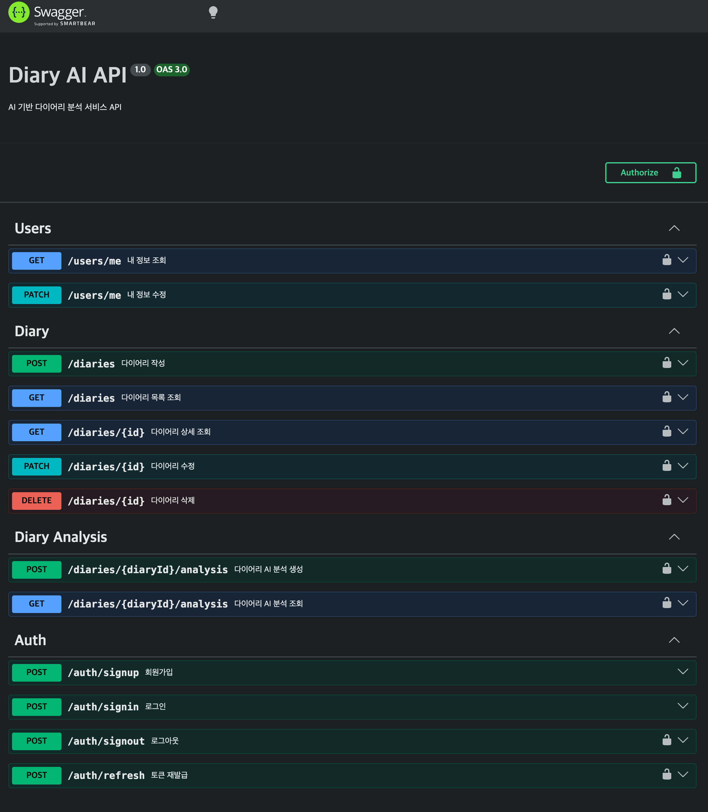

# Diary AI

다이어리를 쓰면 AI가 요약, 주요 감정, 키워드, 걱정, 욕구를 정리해 주는 서비스입니다. NestJS로 백엔드 API를 혼자 만들고 AWS EC2에 배포했습니다.

## 주요 기능

- 이메일 회원가입, JWT 로그인·재발급·로그아웃
- 내 다이어리 작성·조회·수정·삭제, 날짜순 목록과 페이지 조회
- OpenAI로 다이어리 분석 생성·조회. 저장된 결과가 있으면 다시 사용합니다.
- 본문이 바뀌면 기존 분석을 삭제하고, 제목이나 날짜만 바꾸면 분석은 유지합니다.

## 작업하면서 해결한 문제

- **같은 다이어리에 분석 요청이 겹칠 때** PostgreSQL의 조건부 `UPDATE`로 한 요청만 분석을 시작하게 했습니다. Redis 도입 전 테스트 DB에서 동시 요청 10건을 보내, 가짜 OpenAI 호출 1회와 나머지 9건의 `409`를 확인했습니다.
- **OpenAI 비용을 제한하기 위해** 실제 호출 직전에 Redis에서 사용자별 횟수를 셉니다. 첫 호출부터 24시간 동안 10회까지 허용합니다.
- **사용자별 다이어리 목록을 조회할 때** 조회 조건과 날짜 정렬에 맞춰 `(userId, diaryDate)` 인덱스를 추가했습니다. 로컬 PostgreSQL에 약 10만 건을 넣고 각각 5회씩 측정했을 때 평균 **15.952 ms → 0.278 ms**였습니다. 목록의 페이지 처리와 전체 건수 조회를 제외한 **SQL 실행 시간**입니다.

문제가 생긴 이유, 수정 과정, 검증 방법은 [트러블슈팅](./docs/TROUBLESHOOTING.md)에 적었습니다.

## 사용 기술

| 구분 | 기술 |
| --- | --- |
| API | TypeScript, NestJS, JWT, Swagger |
| 데이터 | PostgreSQL, TypeORM, Redis |
| AI | OpenAI Responses API, JSON Schema |
| 배포·운영 | AWS EC2·RDS, Docker Compose, Sentry, GitHub Actions |
| 테스트 | Jest, Supertest |

API는 다이어리와 분석 결과를 PostgreSQL에 저장하고, 사용자별 AI 호출 횟수는 Redis에 저장합니다. DB 구조는 TypeORM 마이그레이션으로 관리합니다.

## API 확인

서버를 켜고 [Swagger](http://localhost:3000/api)를 열면 전체 API를 확인할 수 있습니다. 인증이 필요한 요청에는 `Authorization: Bearer <token>` 헤더를 보냅니다.

| API | 설명 |
| --- | --- |
| `POST /auth/signup`, `POST /auth/signin` | 회원가입, 로그인 |
| `POST /auth/refresh`, `POST /auth/signout` | 토큰 재발급, 로그아웃 |
| `GET /users/me`, `PATCH /users/me` | 내 정보 조회, 닉네임 수정 |
| `POST /diaries`, `GET /diaries?page=1&take=20` | 다이어리 작성, 내 다이어리 목록 |
| `GET /diaries/:id`, `PATCH /diaries/:id`, `DELETE /diaries/:id` | 다이어리 상세 조회, 수정, 삭제 |
| `POST /diaries/:diaryId/analysis`, `GET /diaries/:diaryId/analysis` | 분석 생성, 저장된 분석 조회 |



## 로컬에서 실행하기

Node.js, Docker, OpenAI API 키가 필요합니다. 프로젝트 루트에 `.env.local`을 만들고 값을 채웁니다. PostgreSQL은 Docker Compose 기본값을 쓰면 `localhost:5439`에 연결됩니다.

```dotenv
REDIS_HOST=localhost
REDIS_PORT=6379
JWT_ACCESS_SECRET=<임의의 긴 문자열>
JWT_REFRESH_SECRET=<Access와 다른 긴 문자열>
OPENAI_API_KEY=<본인 키>
CORS_ORIGIN=http://localhost:5173
```

```bash
npm ci
docker compose up -d
npm run build
npm run migration:run
npm run start:dev
```

마이그레이션은 빌드 결과인 `dist/migrations`에서 읽습니다.

## 테스트

- `npm test`는 DB와 외부 서비스를 Mock으로 바꿔 분석 재사용, 호출 실패, 제목·본문 수정, DTO 검증 등을 확인합니다. GitHub Actions에서 `main` 대상 PR과 `main` push 때 빌드와 함께 실행합니다.
- `npm run test:e2e`는 테스트용 PostgreSQL DB와 로컬 Redis를 사용합니다. OpenAI 호출은 가짜 구현으로 바꿔 회원가입부터 분석까지의 흐름과 인증·입력 오류를 확인합니다. 현재 E2E는 로컬에서 실행합니다.

로컬 Docker Compose를 실행한 뒤, 처음 한 번 테스트 DB를 만들고 마이그레이션을 적용합니다.

```bash
docker compose exec postgres createdb -U diary diary_test
npm run build
NODE_ENV=test DB_DATABASE=diary_test npm run migration:run
npm run test:e2e
```

## 남은 작업

- 같은 날짜의 다이어리는 서비스에서 먼저 확인하지만, 동시 작성까지 막으려면 DB 제약을 추가해야 합니다.
- 토큰 재발급과 로그아웃이 겹칠 때 토큰 해시가 다시 저장될 수 있어, 해시를 교체하는 조건과 동시 요청 테스트를 보완해야 합니다.
- 분석 락의 실제 DB 검증을 자동화하고, E2E를 GitHub Actions에서도 실행할 계획입니다.
- 운영 HTTPS와 RDS 인증서 검증을 적용하고, 수동 배포를 줄일 계획입니다.
