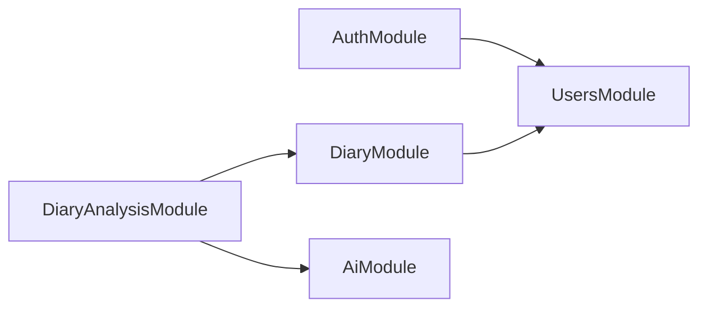
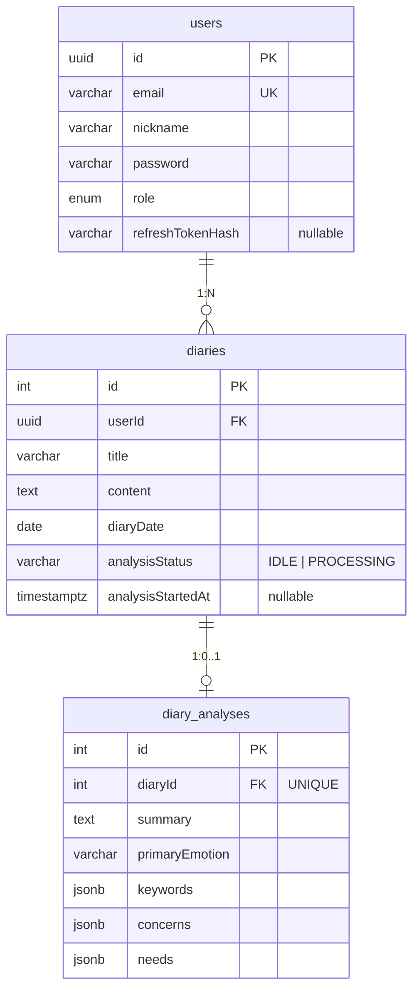
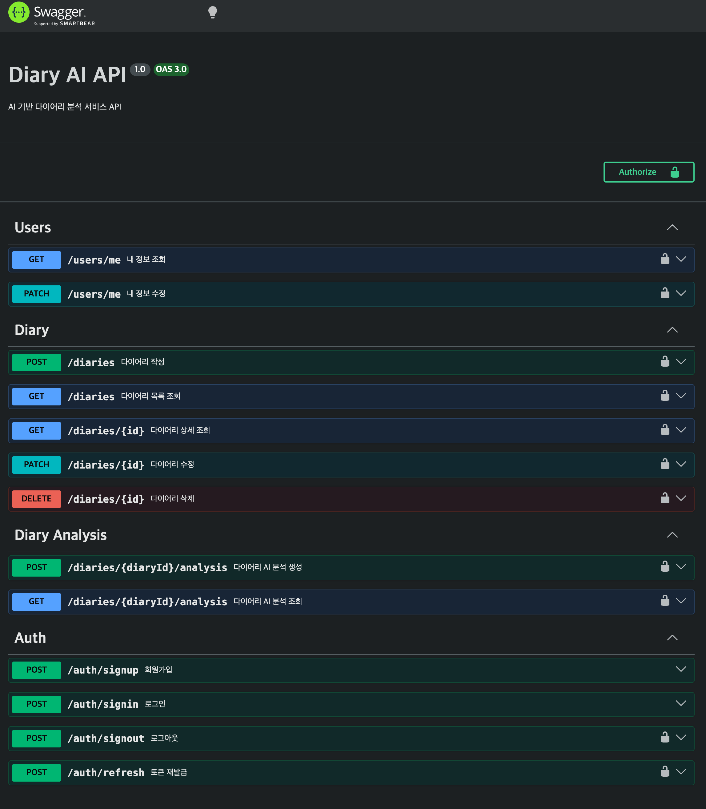
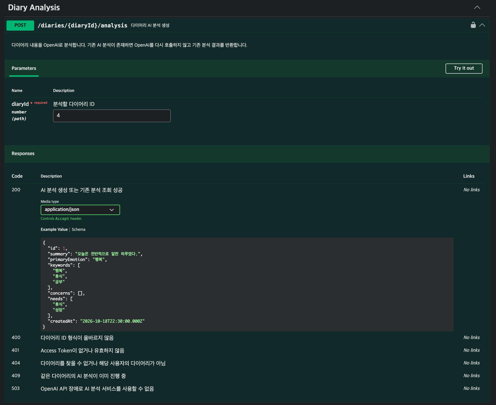

# Diary AI

일기를 작성하면 OpenAI가 본문을 분석해 **요약 · 주요 감정 · 키워드 · 걱정 · 욕구**를 돌려주는 다이어리 서비스의 백엔드 API입니다. (1인 개발)

## 1. 프로젝트 소개

### 배경과 해결하려는 문제

일기는 쓰는 것보다 다시 읽고 돌아보는 일이 더 어렵습니다. 이 서비스는 일기 한 편을 구조화된 분석 결과로 바꿔서 그날의 감정과 고민을 바로 확인할 수 있게 합니다.

백엔드에서 다룬 핵심 문제는 다음과 같습니다.

| 문제 | 접근 |
| --- | --- |
| 외부 AI API는 느리고, 비용이 들고, 실패할 수 있다 | 일기당 분석 1회 저장 후 재사용, 동시 요청 시 1회만 호출, 실패 시 503 + 락 해제 |
| 일기 본문과 분석 결과가 어긋날 수 있다 | 본문이 바뀌면 같은 트랜잭션에서 기존 분석 삭제 |
| 사용자별 목록 조회는 데이터가 늘수록 비용이 커진다 | `(userId, diaryDate)` 복합 인덱스 + `EXPLAIN ANALYZE` 측정 |

### 핵심 기능

- JWT 인증 (Access / Refresh Token, Refresh Token Rotation)
- 일기 CRUD, 본인 일기만 접근
- 페이지 기반 목록 조회
- OpenAI 기반 일기 분석 생성 · 조회

## 2. 기술 스택

| 분류 | 기술 | 근거 |
| --- | --- | --- |
| Backend | TypeScript, NestJS 11, Passport JWT, argon2, class-validator, Swagger | `package.json`, `src/main.ts` |
| Database | PostgreSQL 17, TypeORM (마이그레이션으로 스키마 관리, `synchronize: false`) | `docker-compose.yaml`, `src/config/typeorm.ts` |
| AI | OpenAI Node SDK, Responses API + JSON Schema 구조화 출력 | `src/ai/ai.service.ts` |
| Infrastructure | AWS EC2 (수동 배포, forever로 프로세스 실행), AWS RDS (production DB, SSL 연결), Docker Compose (로컬 DB) | `docker-compose.yaml`, `src/config/typeorm.ts`, `package.json` |
| Test | Jest, ts-jest | `package.json` |
| Frontend | Flutter (별도 저장소) | — |

## 3. 시스템 아키텍처

```mermaid
flowchart LR
    App[Flutter 앱] -->|HTTP JSON\nAuthorization: Bearer| API

    subgraph API[NestJS]
        direction TB
        Pipe[ValidationPipe\nwhitelist, transform] --> Guard[AccessTokenGuard /\nRefreshTokenGuard]
        Guard --> Ctrl[Controller]
        Ctrl --> Svc[Service]
        Svc --> Ser[ClassSerializerInterceptor\n@Exclude 필드 제거]
    end

    Svc -->|TypeORM| DB[(PostgreSQL\nlocal: Docker\nprod: AWS RDS)]
    Svc -->|AiService\ntimeout 60s, retry 0| OpenAI[OpenAI Responses API]
```

### 모듈 의존 관계



- 의존 방향이 한쪽으로만 흐르고 순환 의존이 없습니다.
- OpenAI 호출은 `AiModule`에만 두어서, 분석 흐름(락, 저장)과 외부 API 호출 코드를 분리했습니다.

## 4. 주요 기능

### 회원가입 및 JWT 인증

| 항목 | 구현 | 이유 |
| --- | --- | --- |
| 비밀번호 저장 | argon2 해시 | 평문 저장 금지, 단방향 해시 |
| 토큰 | Access 15분 / Refresh 7일, 서로 다른 시크릿 | Access 탈취 시 피해 시간 제한 |
| Refresh Token 저장 | 원문이 아닌 argon2 해시를 `users.refreshTokenHash`에 저장 | DB 유출 시 토큰 재사용 방지 |
| 재발급 | 새 Refresh Token을 발급하고 해시를 교체 (Rotation) | 이전 Refresh Token은 더 이상 통과하지 못함 |
| 로그아웃 | `refreshTokenHash`를 `NULL`로 변경 | 서버 측에서 재발급 차단 |
| 응답 노출 차단 | `password`, `refreshTokenHash`에 `@Exclude()` + 전역 `ClassSerializerInterceptor` | 엔티티를 그대로 반환해도 민감 필드 제외 |

### 일기 CRUD

- 모든 조회 · 수정 · 삭제는 `WHERE id = :id AND userId = :userId`로 조회합니다. 다른 사용자의 일기는 **404**로 응답해 존재 여부를 노출하지 않습니다.
- 입력 검증: 제목 1~30자, 본문 1~5000자, `diaryDate`는 날짜 문자열.
- 수정 DTO는 `PartialType(..., { skipNullProperties: false })`로 만들어 필드 생략은 허용하고, `null` 입력은 거부합니다. (NOT NULL 컬럼에 `null`이 들어가 500이 나는 것을 막음)

### 일기 목록 및 페이지네이션

- `GET /diaries?page=1&take=20`, `take`는 1~100으로 제한합니다.
- `diaryDate` 내림차순 정렬, 응답은 `{ data, total }`.
- `findAndCount()` 사용 → 목록 조회와 `COUNT` 쿼리가 함께 실행됩니다.

### AI 일기 분석

```
POST /diaries/:diaryId/analysis
  1. 본인 일기 확인 (없으면 404)
  2. 저장된 분석이 있으면 OpenAI 호출 없이 반환
  3. 조건부 UPDATE로 분석 락 선점 (실패하면 409)
  4. 락 획득 후 분석 결과를 한 번 더 확인
  5. OpenAI 호출 → diary_analyses에 저장
  6. finally: 내가 잡은 락만 해제
```

- 응답 형식은 JSON Schema(`strict: true`)로 고정해 필드 누락을 막았습니다.
- OpenAI 실패 시 원본 오류는 서버 로그에만 남기고, 클라이언트에는 **503**으로 응답합니다.

## 5. 데이터베이스 설계



| 제약 · 인덱스 | 목적 |
| --- | --- |
| `users.email` UNIQUE | 이메일 중복 가입 방지 (애플리케이션 중복 확인과 별개로 DB에서 보장) |
| `diaries.userId` FK `ON DELETE CASCADE` | 사용자 삭제 시 일기 함께 삭제 |
| `diary_analyses.diaryId` FK `ON DELETE CASCADE` + UNIQUE | 일기당 분석 결과 최대 1건, 일기 삭제 시 함께 삭제 |
| `IDX_diaries_user_diary_date (userId, diaryDate)` | 사용자별 목록 조회 (`WHERE userId ORDER BY diaryDate DESC`) |
| `analysisStatus`, `analysisStartedAt` | 분석 락 상태와 획득 시각 (TTL 판단, 소유권 확인) |

- 분석 결과의 `keywords`, `concerns`, `needs`는 개수가 정해지지 않은 문자열 배열이고 개별 검색을 하지 않아서 별도 테이블 대신 `jsonb`로 저장했습니다.
- 스키마는 `synchronize: false`로 두고 마이그레이션 5개로만 변경했습니다. (`src/migrations`)

## 6. 기술적 문제 해결

상세 과정: [docs/TROUBLESHOOTING.md](./docs/TROUBLESHOOTING.md)

| 문제 | 원인 | 해결 | 검증 |
| --- | --- | --- | --- |
| 동시 분석 요청 시 OpenAI 중복 호출 | "분석 있음?" 조회와 "분석 시작"이 분리되어 있어 사이에 다른 요청이 끼어듦 | `UPDATE ... WHERE analysisStatus = 'IDLE'` 한 문장으로 락 선점, `affected = 1`인 요청만 진행 | 단위 테스트 + 실제 DB 수동 검증 |
| 서버가 죽으면 락이 `PROCESSING`으로 영구히 남음 | 락 해제를 애플리케이션의 `finally`에만 의존 | 락 TTL 5분. 만료된 락은 재획득 가능 | 실제 DB 수동 검증 |
| 만료 후 늦게 끝난 작업이 새 작업의 락을 해제 | 해제 조건에 "누가 잡은 락인지"가 없음 | 해제 조건에 획득 시각(`analysisStartedAt`) 포함 | 단위 테스트 + 실제 DB 수동 검증 |
| 락만 바뀌어도 일기 `updatedAt`이 갱신됨 | TypeORM `@UpdateDateColumn`이 `update()` 시 `updatedAt = CURRENT_TIMESTAMP`를 자동 추가 | set에 `updatedAt: () => '"updatedAt"'` 지정 | 실행 SQL 확인 + 실제 DB 수동 검증 |
| 본문 수정 후 이전 본문의 분석이 남음 | 일기와 분석이 별도 테이블 | 본문이 실제로 바뀐 경우에만 `DataSource.transaction()` 안에서 일기 저장 + 분석 삭제 | 단위 테스트 (분기) |
| OpenAI 장애 | 외부 API 실패 / 지연 | timeout 60초, 재시도 0회, 503 응답, `finally`로 락 해제 | 단위 테스트 + 실제 DB 수동 검증 |

**락 방식을 고른 이유**: PostgreSQL 행 락이나 advisory lock은 OpenAI 응답을 기다리는 동안 DB 커넥션을 점유합니다. Redis는 현재 규모에 비해 인프라 부담이 큽니다. 그래서 컬럼 2개와 조건부 UPDATE만으로 구현할 수 있는 TTL 락을 선택했습니다. OpenAI 호출 상한(60초)이 TTL(5분)보다 짧도록 맞췄습니다.

## 7. 성능 개선

사용자별 일기 목록 조회에 `(userId, diaryDate)` 복합 인덱스를 추가하고 `EXPLAIN (ANALYZE, BUFFERS)`의 Execution Time을 비교했습니다.

| 조건 | 값 |
| --- | --- |
| 환경 | 로컬 PostgreSQL (Docker `postgres:17`) |
| 데이터 | `diaries` 약 100,003건, 대상 사용자 101건 ([시드 SQL](./src/diary/sql/seed-performance-data.sql)) |
| 쿼리 | `SELECT * FROM diaries WHERE "userId" = $1 ORDER BY "diaryDate" DESC` |
| 횟수 | 인덱스 적용 전 · 후 각 5회 |

| | 평균 | 중앙값 | 범위 |
| --- | ---: | ---: | ---: |
| 적용 전 | 15.952 ms | 13.740 ms | 11.378 ~ 21.507 ms |
| 적용 후 | 0.278 ms | 0.249 ms | 0.064 ~ 0.591 ms |

- 평균 기준 약 57배(실행 시간 98.3% 감소), 중앙값 기준 약 55배.
- DB 실행 시간만 측정했고, API 응답 시간은 포함하지 않습니다.
- 측정 쿼리에는 실제 API의 `LIMIT/OFFSET`과 `COUNT`가 빠져 있습니다. 한계와 재측정 계획은 [성능 트러블슈팅](./docs/TROUBLESHOOTING.md#1-일기-목록-조회-성능-개선-복합-인덱스)에 정리했습니다.

측정 SQL: [before](./src/diary/sql/performance/diary-list-before.sql) / [after](./src/diary/sql/performance/diary-list-after.sql) · 마이그레이션: [`AddDiaryUserDiaryDateIndex`](./src/migrations/1791653488772-AddDiaryUserDiaryDateIndex.ts)

## 8. API 명세

Swagger: 서버 실행 후 `http://localhost:3000/api`. 토큰은 `Authorization: Bearer <token>` 헤더로 보냅니다.





| Method | Endpoint | 인증 | 설명 | 주요 응답 |
| --- | --- | --- | --- | --- |
| POST | `/auth/signup` | - | 회원가입 (`email`, `nickname` 2~30자, `password` 8자 이상 · 영문+숫자) | 201, 400, 409 |
| POST | `/auth/signin` | - | 로그인, Access · Refresh Token 발급 | 200, 400, 401 |
| POST | `/auth/signout` | Access | 로그아웃 (Refresh Token 해시 삭제) | 200, 401 |
| POST | `/auth/refresh` | Refresh | 토큰 재발급 (Rotation) | 200, 401 |
| GET | `/users/me` | Access | 내 정보 조회 | 200, 404 |
| PATCH | `/users/me` | Access | 닉네임 수정 | 200, 400 |
| POST | `/diaries` | Access | 일기 작성 | 201, 400 |
| GET | `/diaries?page=&take=` | Access | 내 일기 목록 (`page` ≥ 1, `take` 1~100, 기본 20) | 200, 400 |
| GET | `/diaries/:id` | Access | 일기 상세 | 200, 404 |
| PATCH | `/diaries/:id` | Access | 일기 수정 (본문 변경 시 분석 삭제) | 200, 400, 404 |
| DELETE | `/diaries/:id` | Access | 일기 삭제 (분석 CASCADE 삭제) | 200, 404 |
| POST | `/diaries/:diaryId/analysis` | Access | AI 분석 생성. 이미 있으면 저장된 결과 반환 | 200, 404, 409, 503 |
| GET | `/diaries/:diaryId/analysis` | Access | AI 분석 조회 | 200, 404 |

## 9. 실행 방법

준비물: Node.js, Docker, OpenAI API 키

### 환경 변수

`NODE_ENV`에 따라 `.env.${NODE_ENV}` 파일을 읽습니다. 값이 없으면 `.env.local`을 읽습니다. 프로젝트 루트에 `.env.local`을 만듭니다.

```dotenv
# DB (생략하면 아래 docker-compose 기본값 사용)
DB_HOST=localhost
DB_PORT=5439
DB_USERNAME=diary
DB_PASSWORD=diary
DB_DATABASE=diary_service

# 필수
JWT_ACCESS_SECRET=<임의의 긴 문자열>
JWT_REFRESH_SECRET=<임의의 긴 문자열>
OPENAI_API_KEY=<본인 키>
```

`.env.local`, `.env.production`은 `.gitignore`에 포함되어 있습니다.

### 실행

```bash
npm ci
docker compose up -d      # PostgreSQL 17 → localhost:5439
npm run build             # 마이그레이션 경로가 dist/migrations 이므로 먼저 빌드
npm run migration:run
npm run start:dev         # http://localhost:3000, Swagger: /api
```

production 실행(`npm run start:prod`)은 전역으로 설치된 `forever`를 사용합니다.

## 10. 테스트 및 검증

### 자동화 테스트 (Jest, `npm test`)

Repository · 외부 의존성을 Mock으로 대체한 **단위 테스트**입니다. 4개 파일, 11개 케이스.

| 대상 | 검증 내용 |
| --- | --- |
| `DiaryAnalysisService` (5) | 저장된 분석 재사용 시 OpenAI 미호출 / 신규 분석 저장 / 타인 일기면 OpenAI 미호출 / OpenAI 실패 시 미저장 + 획득 시각으로 락 해제 / 락 선점에 실패한 요청은 거절되고 OpenAI는 1회만 호출 |
| `DiaryService` (2) | 제목만 수정하면 분석 유지 / 본문을 수정하면 분석 삭제 |
| `UpdateDiaryDto`, `UpdateProfileDto` (4) | 필드 생략 허용 / `null` 입력 거부 |

동시성 테스트는 `tryStartAnalysis`의 결과를 Mock으로 정해 두고 **서비스 분기**를 검증합니다. 조건부 UPDATE의 원자성처럼 SQL 자체의 동작은 이 테스트로 보장되지 않습니다.

### 수동 검증 (저장소에 미포함)

| 방식 | 내용 |
| --- | --- |
| Postman | 회원가입 → 로그인 → 일기 작성 → AI 분석 전체 흐름 / 토큰 없이 요청 시 401 / 다른 사용자 일기 조회 시 404 / 토큰 재발급 후 이전 Refresh Token 재사용 시 401 |
| 실제 PostgreSQL + 임시 검증 스크립트 | 동시성 검증은 이 스크립트로만 진행. 분석 락 14개 시나리오: 동시 10회 요청 시 OpenAI 1회, TTL 경계값(4분 59초 / 5분 1초), 고착된 락 재획득, 이전 작업의 해제 차단, `updatedAt` 유지 등. 결과는 [TROUBLESHOOTING](./docs/TROUBLESHOOTING.md) 3·4번에 기록 |
| `psql` `EXPLAIN ANALYZE` | 목록 조회 인덱스 전후 측정 (7번) |

## 11. 개선 예정 사항

**알려진 한계**

- 분석 중에 본문을 수정하면 수정 전 본문의 분석 결과가 저장될 수 있습니다.
- 락 만료 후 늦게 끝난 작업이 결과를 저장하면 UNIQUE 위반(`23505`)으로 500이 납니다. (UNIQUE 제약 때문에 데이터는 1건만 유지됨)
- 목록 정렬 키가 `diaryDate` 하나뿐이라, 같은 날짜의 일기가 페이지 경계에 걸리면 순서가 바뀔 수 있습니다.

**기술 과제**

- 실제 PostgreSQL 기반 통합 · e2e 테스트를 저장소에 포함해 자동화
- 전역 예외 필터로 에러 응답 형식 통일
- 로그인 · AI 분석 API Rate Limit
- 환경 변수 검증, RDS SSL 인증서 검증 (`rejectUnauthorized: false` 제거)
- Docker 이미지화, GitHub Actions CI (현재는 EC2에 수동 배포)
- HTTPS 적용 (현재 HTTP) 및 운영 환경 Swagger 비공개 처리
